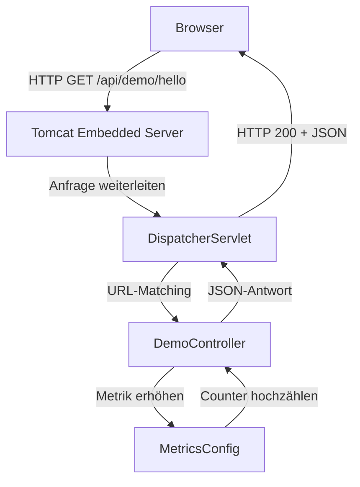
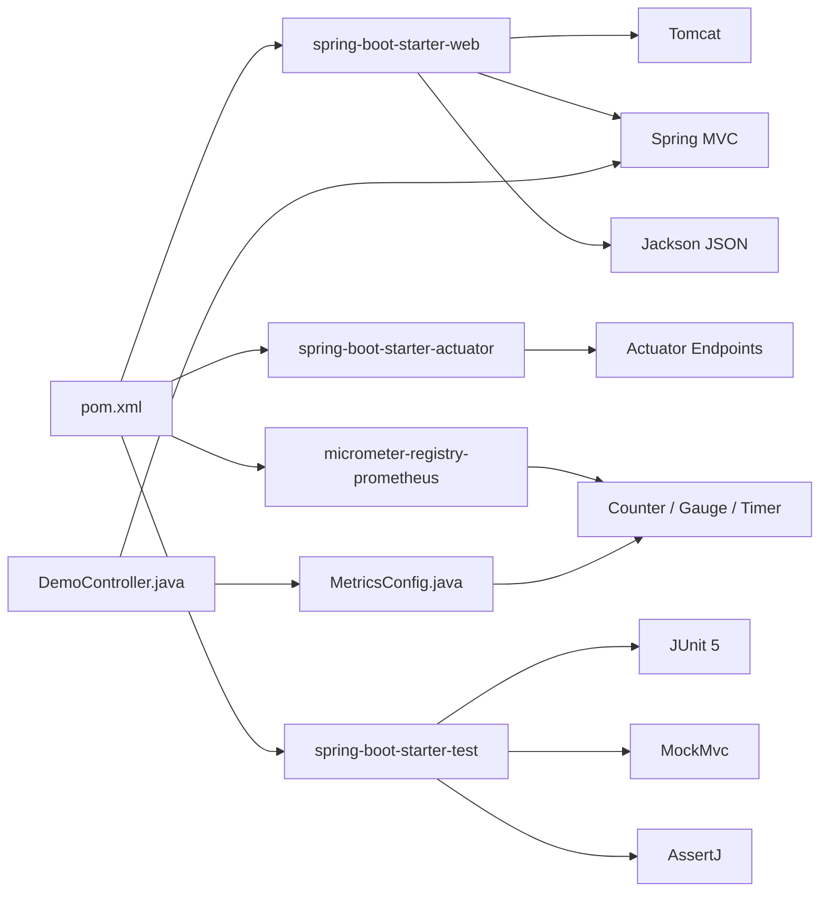

# Spring Boot Monitoring App

Spring Boot-Anwendung mit Prometheus und Grafana zum Überwachen von CPU, Speicher und HTTP-Anfragen.

## Architektur

Alle drei Komponenten — Spring Boot App, Prometheus und Grafana — laufen in Docker-Containern im selben Netzwerk. Prometheus fragt alle 15 Sekunden `/actuator/prometheus` der App ab und speichert die Metriken. Grafana liest von Prometheus und visualisiert die Daten auf Port 3000.

```
+---------------------+     +---------------------+
|  Spring Boot App    |     |  Docker Desktop     |
|  Port 8080          |     |                     |
|                     |     | +-----------+       |
| /actuator/prometheus|---->| Prometheus  |       |
|                     |     | Port 9090   |       |
+---------------------+     |     |       |       |
                            |     v       |       |
                            | +-----------+       |
                            | |  Grafana    |     |
                            | | Port 3000   |     |
                            | +-------------+     |
                            +---------------------+
```

Datenfluss:

```
App (8080) → Prometheus (9090) → Grafana (3000)
```

## Anfrage-Flow

Wenn eine URL wie `http://localhost:8080/api/demo/hello` aufgerufen wird, durchläuft die Anfrage mehrere Schichten:



## Dependencies

Die `pom.xml` definiert die benötigten Bibliotheken. Maven lädt automatisch alle transitiven Abhängigkeiten:



## Projektstruktur

```
SpringBoot_Monitoring_APP_DevOps/
├── src/
│   ├── main/
│   │   ├── java/com/monitoring/
│   │   │   ├── MonitoringApplication.java
│   │   │   ├── controller/DemoController.java
│   │   │   └── config/MetricsConfig.java
│   │   └── resources/
│   │       ├── application.properties
│   │       └── static/index.html
│   └── test/java/com/monitoring/
│       ├── MonitoringApplicationTests.java
│       ├── controller/DemoControllerTest.java
│       └── config/ActuatorEndpointTest.java
├── docker-compose.yml
├── Dockerfile
├── prometheus/prometheus.yml
├── grafana/
│   ├── dashboards/monitoring.json
│   └── provisioning/
├── .gitignore
└── Lessons_Learned_Monitoring.md
```

## Endpunkte

| Endpunkt | Methode | Beschreibung |
|----------|---------|-------------|
| `/api/demo/hello` | GET | Begrüßung und Visit-Count |
| `/api/demo/slow` | GET | Simuliert langsame Antwort (~1 Sekunde) |
| `/api/demo/work` | GET | Simuliert rechenintensive Arbeit |
| `/api/demo/error` | GET | Wirft RuntimeException (HTTP 500) |
| `/api/demo/heavy` | GET | Erzeugt CPU- und Memory-Last (10 Mio. Berechnungen, 50 MB) |

## Custom Metrics

Jeder Endpunkt hat einen eigenen Counter in `MetricsConfig.java`:

| Metrik | Endpunkt |
|--------|----------|
| `app.hello.count` | `/api/demo/hello` |
| `app.slow.count` | `/api/demo/slow` |
| `app.work.count` | `/api/demo/work` |
| `app.error.count` | `/api/demo/error` |
| `app.heavy.count` | `/api/demo/heavy` |
| `app.slow.duration` | `/api/demo/slow` (Timer) |

## Grafana Dashboard

Das Dashboard `monitoring.json` enthält Panels für CPU Usage, JVM Memory (Heap/Non-Heap), HTTP Request Rate, HTTP Response Time, Active Threads, GC Pause Time, sowie 5 individuelle Counter-Grafiken (/hello, /slow, /work, /error, /heavy).

## Schnellstart

### Voraussetzungen

- Java 17 installiert
- Docker Desktop läuft
- Git installiert

### Projekt klonen

```bash
git clone https://github.com/R-Yanay/SpringBoot_Monitoring_App_DevOps.git
cd SpringBoot_Monitoring_App_DevOps
```

### Umgebungsvariablen einrichten

Kopiere die Beispiel-Umgebungsdatei und passe sie bei Bedarf an:

```bash
cp .env.example .env
```

### Alle Services starten

Ein Befehl startet App, Prometheus und Grafana:

```bash
docker compose up -d
```

Dabei wird das Docker-Image der App gebaut (erster Start dauert ca. 1–2 Minuten).

### Dashboard öffnen

1. `http://localhost:3000` im Browser öffnen
2. Login: **admin** / **admin**
3. Links: **Dashboards** → **Browse** → **Spring Boot Monitoring**

### Services stoppen

```bash
docker compose down
```

### Alternative: Nur die App lokal entwickeln

Für lokale Entwicklung ohne Docker-Container der App:

```bash
mvn spring-boot:run
```

Dann nur Prometheus und Grafana in Docker starten:

```bash
docker compose up -d prometheus grafana
```

In diesem Fall muss `prometheus/prometheus.yml` auf `host.docker.internal:8080` zeigen.

## Tests

9 Tests in 3 Klassen:

| Test-Klasse | Anzahl | Inhalt |
|-------------|--------|--------|
| `MonitoringApplicationTests` | 1 | App startet ohne Fehler |
| `DemoControllerTest` | 5 | Alle 5 Demo-Endpunkte |
| `ActuatorEndpointTest` | 3 | `/health`, `/metrics`, `/prometheus` |

Tests ausführen:

```bash
mvn test
```

## DevOps-Status

| Phase | Status |
|-------|--------|
| CODE | Fertig |
| BUILD | Fertig (GitHub Actions CI/CD) |
| TEST | Fertig (8 Tests) |
| DEPLOY | Fertig (alle 3 Services in Docker) |
| OPERATE | Fertig (4 Alert-Regeln) |
| MONITOR | Fertig (Prometheus + Grafana) |

### Alerting

4 Alert-Regeln in `grafana/provisioning/alerting/rules.yml`:

| Alert | Bedingung | Dauer |
|-------|-----------|-------|
| CPU Warning | `system_cpu_usage > 0.8` | 5 Minuten |
| Memory Warning | JVM Heap > 85% | 5 Minuten |
| Error Rate Critical | > 5% HTTP 5xx-Antworten | 2 Minuten |
| App Down Critical | App nicht erreichbar | 1 Minute |

Alle Alerts zeigen "Normal" (grün) bei fehlenden Daten (`noDataState: OK`).

### Lessons Learned

Dieses Projekt dient als Einstieg in DevOps und deckt den vollständigen Lebenszyklus einer Anwendung ab:

- **Containerisierung**: Eine Java-Anwendung mit Docker verpacken, mehrere Services in einem Netzwerk betreiben und Container-Kommunikation verstehen.
- **Monitoring**: Prometheus als Datensammler und Grafana als Visualisierung einsetzen, PromQL-Abfragen schreiben und Dashboards per Provisioning automatisch laden.
- **Alerting**: Schwellenwerte definieren, Alert-Regeln konfigurieren und das Verhalten bei fehlenden Daten steuern.
- **CI/CD**: Eine Pipeline mit GitHub Actions einrichten, die bei jedem Push automatisch Tests ausführt und Artefakte baut.
- **Tests**: Unit- und Integration-Tests schreiben, um Controller-Endpunkte und Actuator-Metriken zu prüfen.
- **Git & GitHub**: Repository verwalten, `.gitignore` konfigurieren und die Versionshistorie pflegen.
